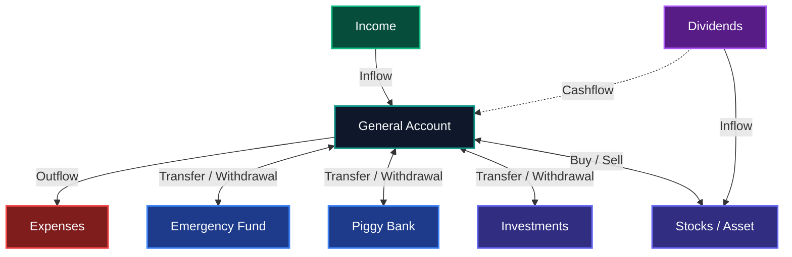

# 📘 MoneyVaults: Finances & FIRE — Official User Guide & Manual

Welcome to **MoneyVaults: Finances & FIRE**, the modern, offline-first personal wealth management and financial freedom operating system.

---

## 📑 Table of Contents

1. [Philosophy & Architecture](#-philosophy--architecture)
2. [The Vaults Interaction Philosophy & Capital Flow Dynamics](#-the-vaults-interaction-philosophy--capital-flow-dynamics)
   - [The Philosophy of Mental Accounting & Purpose-Built Vaults](#the-philosophy-of-mental-accounting--purpose-built-vaults)
   - [Central Clearinghouse: The Single General Account Architecture](#central-clearinghouse-the-single-general-account-architecture)
   - [Capital Flow Architecture Diagram](#capital-flow-architecture-diagram)
   - [Comprehensive Capital Flow Interaction Matrix](#comprehensive-capital-flow-interaction-matrix)
   - [The Budget Surplus / Deficit Equation](#the-budget-surplus--deficit-equation)
3. [Quick Start Guide](#-quick-start-guide)
4. [Understanding Vault Types, Sorting & Custom Ordering](#-understanding-vault-types--sorting)
   - [Savings Goals & Emergency Funds](#savings-goals--emergency-funds)
   - [Dedicated Stock & Asset Vaults (PRU, Units & P&L)](#dedicated-stock--asset-vaults)
   - [Single General Account Architecture & Cash Flow Intelligence](#single-general-account-architecture)
   - [Vault Sorting, Drag & Drop Reordering & Instant Value Replacement](#vault-sorting--instant-value-replacement)
5. [Smart Budget & Two-Level Drilldown](#-smart-budget--two-level-drilldown)
   - [Budget Overview & Time Horizon Tabs](#budget-overview--time-horizon-tabs)
   - [Hierarchical Two-Level Drilldown (Direct Expenses vs Vault Transfers)](#hierarchical-two-level-drilldown)
   - [Future Forecast & Projected Dividend Inflows](#future-forecast--projected-dividend-inflows)
6. [Cash Flow, Calendar View & Transactions](#-cash-flow-calendar-view--transactions)
   - [Interactive Monthly Calendar View](#interactive-monthly-calendar-view)
   - [Fastfill One-Tap Logging](#fastfill-one-tap-logging)
   - [Multi-Criteria Filtering & Tag Manager](#multi-criteria-filtering--tag-manager)
7. [Future Planned Transactions](#-future-planned-transactions)
8. [Recurring Transactions & Smart Alerts](#-recurring-transactions--smart-alerts)
9. [Dividend Tracker, Projections & Multi-Vault Sync](#-dividend-tracker--stock-vault-sync)
10. [Vaults Evolution & Trend Curves (1M, 3M, YTD, 1Y, ALL)](#-vaults-evolution--trend-curves)
    - [Evolution & Trend Curves (Dual Scale & Live P&L %)](#1-evolution--trend-curves-1m-3m-ytd-1y-all)
    - [Monthly Inflow / Outflow & Cumulative Balance Modes](#2-monthly-inflow--outflow--cumulative-balance-modes)
11. [Portfolio Allocation & Weights](#-portfolio-allocation--weights)
12. [Financial Calculators Suite](#-financial-calculators-suite)
    - [Compound Growth & FIRE Calculator](#1-compound-growth--fire-calculator)
    - [Dividend Growth & Yield Calculator](#2-dividend-growth--yield-calculator)
    - [Loan Amortization & Early Payoff](#3-loan-amortization--early-payoff)
    - [Smart Discount Calculator](#4-smart-discount-calculator)
13. [Interactive Tutorials & Demo Mode](#-interactive-tutorials--demo-mode)
14. [Smart Reminders & Notifications](#-smart-reminders--notifications)
15. [Data Center, Cloud Backup & Biometric Privacy](#-data-center-cloud-backup--privacy)
16. [Membership Plans (Standard vs Premium)](#-membership-plans-standard-vs-premium)
17. [Frequently Asked Questions (FAQ)](#-frequently-asked-questions-faq)
18. [Support & Contact](#-support--contact)

---

## 🏛️ Philosophy & Architecture

MoneyVaults is built upon three non-negotiable principles:

* **100% Offline-First Privacy:** Your finances are your business. MoneyVaults does not require an account, does not connect to external financial servers, and never sells or uploads your data. All records remain stored locally on your device.
* **Mathematical Precision:** No ambiguous projections. Every compound growth curve, loan amortization schedule, historical evolution curve, and portfolio weighting formula is built on transparent financial math.
* **Frictionless Daily Tracking:** With customizable **Fastfill** buttons, auto-selected quick update inputs, and an interactive **Calendar View**, logging a daily transaction or portfolio update takes less than two seconds.

---

## 🔄 The Vaults Interaction Philosophy & Capital Flow Dynamics

MoneyVaults avoids the pitfall of traditional budgeting apps that lump all liquid capital into a single unorganized bucket. Instead, it utilizes an advanced **multi-vault mental accounting framework** designed to balance immediate lifestyle needs against long-term compounding growth.

### 1. The Philosophy of Mental Accounting & Purpose-Built Vaults
Traditional financial tracking often causes anxiety because money meant for living expenses is mixed with emergency reserves or stock purchases. MoneyVaults solves this by compartmentalizing money into dedicated vaults:
* **General Account:** Operational clearinghouse for routine living expenses, cash flow balance, and primary income.
* **Emergency Fund:** Dedicated runway reserve preserving 3–12 months of living expenses shielded from daily spending.
* **Piggy Bank:** Goal-directed savings for specific milestones (vacations, vehicle, tech, down payment).
* **Investments:** Compounding wealth portfolios (ETFs, index funds, compound interest simulation).
* **Stocks / Asset:** Equity and asset holdings with real unit tracking, weighted average cost basis (PRU), and live P&L.

### 2. Central Clearinghouse: The Single General Account Architecture
The **General Account** operates as the central clearinghouse of your entire financial life:
* All **Income** (such as salaries, bonuses, or freelance income) flows into the **General Account**.
* All **Expenses** exit directly from the **General Account**.
* When you allocate capital or save, funds move from the **General Account** into the target vault (**Emergency Fund**, **Piggy Bank**, **Investments**, or **Stocks / Asset**).
* When you withdraw capital from reserves, it returns directly to the **General Account**.

> [!IMPORTANT]
> **Single General Account Rule:** To maintain unambiguous mathematical integrity in budget calculations, cash flow surplus tracking, and inter-vault transfers, MoneyVaults features **strictly one General Account**. Additional vaults can be created without limit for Emergency Reserves, Piggy Banks, Investments, and Stock Assets, but all operational living cash flows through the single clearinghouse.

### 3. Capital Flow Architecture Diagram

The flow of funds between external income, your General Account, and your specialized wealth vaults follows a clear, predictable circuit using the exact terminology from the app interface:

### 4. Comprehensive Capital Flow Interaction Matrix

Every event in MoneyVaults updates the corresponding vaults with strict mathematical consistency:

| Event / Operation (App UI) | General Account | Destination / Origin Vault | Budget Surplus / Deficit Impact | Vaults Monthly Evolution Mode |
| :--- | :--- | :--- | :--- | :--- |
| **Income** *(Salary, Freelance, Business)* | **+ Inflow** (Direct Income) | *None* | Increases Monthly Surplus | General Account: Inflow |
| **Expenses** *(Groceries, Dining, Utilities)* | **- Outflow** (Direct Expense) | *None* | Decreases Monthly Surplus | General Account: Outflow |
| **Transfer to Vault** *(Emergency, Piggy, Investments)* | **- Outflow** (Capital Allocation) | **+ Inflow** (Capital Received) | Decreases General Cash | Destination Vault: Inflow |
| **Withdrawal from Vault** *(e.g. from Emergency Fund)* | **+ Inflow** (Capital Drawdown) | **- Outflow** (Capital Withdrawn) | Increases General Cash | Origin Vault: Outflow |
| **Stocks / Asset: Buy** *(Buy Shares / Units)* | **- Outflow** (Capital Allocation) | **+ Inflow** (Units & PRU Basis) | Decreases General Cash | Asset Vault: Inflow |
| **Stocks / Asset: Sell** *(Sell Shares / Units)* | **+ Inflow** (Liquidation Proceeds) | **- Outflow** (Units Disposed) | Increases General Cash | Asset Vault: Outflow |
| **Dividends: Received (to General Account)** | **+ Cashflow (Inflow)** | *None* | Increases Monthly Surplus | General Account: Inflow |
| **Dividends: Received (to Asset / Investment Vault)** | *Neutral (No Cashflow Impact)* | **+ Inflow** (Capital Reinvestment) | Neutral for Budget | Destination Vault: Inflow |
| **Dividends: Projected** *(Upcoming Schedule)* | *Future Cashflow Forecast (if General)* | *Future Inflow Forecast (if Vault)* | Positive Future Inflow | Budget: Upcoming Inflow |

### 5. The Budget Surplus / Deficit Equation

The **Budget** screen is purposefully scoped to measure the operational cash performance of your **General Account** (your everyday checking / clearinghouse account). It does not muddle your lifestyle budget with internal asset balance changes.

$$\text{Budget Surplus / Deficit} = \text{Total Inflows} - \text{Total Outflows}$$

Where:

$$\text{Total Inflows} = \text{Income} + \text{Dividends (to General Account)} + \text{Vault Returns (Withdrawals / Asset Sales)}$$

$$\text{Total Outflows} = \text{Expenses} + \text{Transfers to Vaults (Savings Allocations / Asset Buys)}$$

This formulation guarantees that:
1. **Clear Income & Passive Cash:** Regular employment income and dividends intended for living expenses (Cashflow to General Account) are recognized as spendable inflows.
2. **True Savings & Asset Purchases:** Moving money to your Emergency Fund, funding a savings goal, or buying an ETF correctly reflects as an outflow leaving your everyday account.
3. **Restoring Liquidity:** Reimbursing yourself from savings or liquidating asset holdings back into the General Account correctly restores operational liquidity (Vault Returns).
4. **Isolated Vault Growth:** Dividends retained inside stock or investment vaults count as internal vault inflows (reinvestments) without distorting everyday lifestyle metrics.

---

## 🚀 Quick Start Guide

1. **Set Your Base Currency:**  
   Open settings or tap the currency indicator to choose your preferred currency symbol (`€`, `$`, `£`, `¥`, `CHF`, `R$`, etc.).
2. **Review or Sort Your Vaults:**  
   Head to the **Vaults** tab to see your foundational accounts (General Account, Emergency Fund, Investment Vault) and sort them by Default, Balance, Name, or Type.
3. **Log Your First Cash Flow:**  
   Tap the central **`+`** button in the bottom navigation (or the leftmost **`+`** button in any Vault Details header) to add an Income, Expense, or Vault transfer.
4. **Explore Tutorials or Demo Mode:**  
   Open the top menu and tap **Tutorials** for step-by-step walkthroughs, or switch on **Demo Mode** to explore a rich pre-populated portfolio with fictional assets.

---

## 🗄️ Understanding Vault Types & Sorting

MoneyVaults organizes your wealth into dedicated, purpose-built vaults:

| Vault Category | Purpose | Key Features |
| :--- | :--- | :--- |
| **💰 Piggy Bank (Savings Goal)** | Short-to-medium term savings goals (Vacation, Car, Tech). | Target amount, percentage progress bar, milestone tracking. |
| **🛡️ Emergency Fund** | Runway reserve for peace of mind. | Monthly burn rate calculator, months of runway covered. |
| **📈 Investment & Wealth** | Compounding assets (ETFs, Funds, Real Estate, Crypto). | Compound growth engine, P&L tracking, auto-reinvestment simulation, capital target. |
| **📊 Stock / Equity Vault** | Individual stocks & ETF portfolio positions. | Ticker symbol, unit tracking, average acquisition cost (PRU), live P&L. |
| **💳 General Account & Everyday** | Central clearinghouse for income, expenses, and transfers. | Fastfill one-tap logging, categorized expenditure summaries, and **Cash Flow Intelligence** (record expenses/incomes, tag analytics, net variation, daily averages). |

### Dedicated Stock & Asset Vaults
* **Ticker Symbol:** Assign market tickers (e.g., `VWCE`, `IWDA`, or fictional demo tickers like `NVTX`, `APXS`).
* **Live Position Metrics:** Automatically tracks net units owned, average acquisition price (PRU), total invested capital, current market valuation, and unrealized profit/loss (both in currency and percentage).
* **Buy & Sell Trades:** Dedicated "Buy" and "Sell" buttons record order quantity, unit price, and broker commission fees.
* **Cash Flow Integration:** Buy trades allocate investment capital from your General Account to build your position, while sell trades liquidate units and return cash directly to your General Account.

### Vault Sorting, Drag & Drop Reordering & Instant Value Replacement
* **Drag & Drop Vault Reordering (Premium):** In the Premium version, customize the order of your vault cards by long-pressing and dragging the 3-dots handle (`⋮⋮`). Your customized sequence is automatically remembered across app sessions.
* **Custom Order Sorting Option:** In the **Sort Vaults** bottom sheet, a dedicated **"Custom Order"** option is available alongside Default, Balance, Name, and Vault Type, allowing you to instantly restore your preferred arrangement at any time.
* **Instant Value Replacement:** When you tap **Update P&L**, **Update Price**, or **Update Base**, the input field opens immediately focused and pre-selected so typing a new number replaces the previous value right away without needing to backspace.
* **Quick Add Transaction:** Inside any Vault Details screen, the **`+`** button to log a new transaction is positioned as the leftmost action in the header bar for rapid access.

### Single General Account Architecture & Cash Flow Intelligence
* The **General Account** is created automatically as your operational default vault.
* To prevent accounting discrepancies in monthly budget surplus and inter-vault capital routing, creating additional General/Expense accounts is intentionally restricted. All operational living expenses and transfers flow through this unified account, while any number of additional Piggy Banks, Emergency Funds, Investment Vaults, and Asset Vaults can be created freely.
* **Cash Flow Intelligence (Premium):** The General Account details screen features an intelligent analytics engine:
  * **Record Expenses & Incomes:** Highlights the single highest expense and highest income of all time, within the active time filter, and broken down by top category tag.
  * **Balance Progression:** Details the exact starting balance, ending balance, and net change (both absolute amount and percentage variation) across the selected timeframe.
  * **Daily Spending Rate:** Computes your average daily burn rate across the active filter window.
  * **Seamless Pro Integration:** This analytics suite is a Premium feature (Free users see an elegant preview lock banner matching the app's visual identity, and the PRO badge is automatically hidden for active Premium users). Fastfill remains conveniently accessible on the General Account card in the main Vaults tab.

---

## 🧭 Smart Budget & Two-Level Drilldown

The **Budget** screen is strictly dedicated to presenting the **Inflows** and **Outflows** of the **General Account** (your everyday operational clearinghouse). It provides complete forward-looking and historical transparency over where your cash came from and where it went.

### 1. Budget Overview & Calculation Formula

In the Budget screen, the financial health of your period is calculated exclusively from the General Account circuit:

* **Inflows:** All incoming operational cash:
  * **Income:** Salaries, freelancing, and direct cash revenues.
  * **Dividends:** Dividend distributions confirmed to the General Account as spendable cash flow.
  * **Vault Returns:** Capital returning to the General Account (withdrawals from Emergency Reserves, redemptions from Piggy Banks, or net proceeds from stock/asset sales).
* **Outflows:** All exiting operational cash:
  * **Expenses:** Routine living expenses (groceries, utilities, dining, subscriptions).
  * **Transfers to Vaults:** Capital allocated away from the General Account to build wealth (savings transferred to Emergency Funds, Piggy Banks, or stock purchases / asset buys).
* **Operational Surplus / Deficit:**
  $$\text{Budget Balance} = \text{Inflows} - \text{Outflows}$$
  * **Surplus (Positive):** Living cash was generated and remained unspent in your checking clearinghouse.
  * **Deficit (Negative):** Spending and vault contributions exceeded incoming revenues, drawing down existing checking balances or requiring vault liquidations.

### 2. Hierarchical Two-Level Drilldown (Direct Expenses vs Vault Transfers)
When inspecting the **General Account Outflows**, MoneyVaults separates operational lifestyle spending from wealth accumulation:

1. **Level 1 — High-Level Differentiation:**
   * **Direct Expenses:** All routine expenditures (Groceries, Dining, Utilities, Subscriptions, Housing).
   * **Vault Transfers (Grouped by Target Vault):** Distinct clusters for capital allocated to other vaults (e.g., "Emergency Fund", "Tech Stocks", "Vacation Piggy").
2. **Level 2 — Transaction & Tag Inspection:**
   * Tapping into **Direct Expenses** reveals the tag breakdown (e.g., `#groceries`, `#transport`, `#health`) with aggregated totals.
   * Tapping into a specific **Vault Transfer** (e.g. `Tech Stocks`) lists all individual purchase transfers made toward that holding.
   * **Protected Header Layout:** The drilldown header features a dedicated breadcrumb trail (`General Account › Outflows`) above the active category title and isolates the total amount badge on the right, completely eliminating text truncation and overlap across all screen densities.

### 3. Future Forecast & Projected Dividend Inflows
When viewing **Next Month** or upcoming budget horizons:
* Upcoming planned transactions and recurring rules are automatically plotted.
* **Scheduled Dividend Inflows:** Recurring and scheduled dividends are calculated based on pay frequency and credited as forecasted inflows into their respective holding vaults, giving you a full, reliable projection of passive income and operational cash.

---

## 💸 Cash Flow, Calendar View & Transactions

The **Cash Flow** tab provides real-time control over liquidity, historical transactions, and future commitments:

* **Net Cash Flow Card:** Real-time breakdown of total Income, total Outflow, and Net Savings.
* **Transaction Logging:** Select date, amount, description, tags, category, and target vault.

### Interactive Monthly Calendar View
Toggle the **Calendar icon** on the Cash Flow screen to switch from the standard list to the **Interactive Monthly Calendar View**:
* **Daily Activity Dots & Totals:** Instantly spot which days have completed transactions, planned future commitments, or recurring rules.
* **Status Filter Pills:** Filter the calendar grid by **All**, **Completed**, **Planned**, or **Recurring**.
* **Inspect, Confirm & Edit Future Items:** Tap any date on the calendar to inspect its scheduled or completed transactions below the grid:
  * **Confirm & Log** due recurring or planned items in one tap.
  * **Edit Future One-Time Planned Transactions** directly from the selected calendar day and save your updated amount, title, or date seamlessly.
  * **Edit Future Recurring Transactions** from the selected calendar day—modifying a future recurring occurrence updates the rule for that selected date and future occurrences without erroneously creating a completed transaction prematurely.

### Fastfill One-Tap Logging
* Configure a fastfill step increment on expense vaults (e.g. `5`, `10`, `25`) to log frequent routine items with a single tap.

### Multi-Criteria Filtering & Tag Manager
* **Multi-Criteria Filter Bar:** Filter transactions simultaneously on your Cash Flow dashboard:
  * **Title Search:** Instant keyword search across all transaction descriptions.
  * **Categories Filter:** Multi-select modal to filter by specific transaction categories.
  * **Vaults Filter:** Focus on movements associated with particular vaults.
  * **Tags Filter:** Filter by custom tags created in the Tag Manager.
  * **Status Filter:** Filter by Settled transactions, One-Time Planned commitments, or Recurring rules.
  * **Time Range Horizon:** Switch between `All Time`, `This Month`, `Last 30 Days`, `Last Month`, `Last 3M`, `Last 6M`, `YTD`, `Last Year`, or a `Custom Date Range`.
* **Tag Manager:** Open the Tag Manager from the top bar to create custom tags with dedicated color badges.

---

## 📅 Future Planned Transactions

Plan future commitments and avoid surprises:
* **Future Dating:** In any transaction form, pick a future date to record an upcoming planned expense or expected income (e.g. quarterly insurance, travel bookings, tax bills).
* **Cash Flow Shielding:** Planned transactions do not alter your current liquid balance until their due date arrives.
* **Calendar & Scheduled View:** View and edit planned commitments directly in the **Monthly Calendar View** (filtering by *Planned*) or via the Scheduled section.
* **Settlement Day Confirmation:** When the scheduled date arrives, the app prompts you to confirm, modify, or reschedule the final settlement into your permanent history.

---

## 🔁 Recurring Transactions & Smart Alerts

Automate routine obligations:
* **Calendar Recurrence Rules:** Set rules for rent, salaries, gym memberships, or ETF savings plans with customized recurrence intervals ($x$ Days, Weeks, Months, or Years), specific monthly due days (1–31), and notification times.
* **Device Notifications:** Receive local push notifications when a payment is due.
* **Pending Confirmations & Calendar Editing:** Review due items with full control (**"Confirm & Log"**, **"Modify & Log"**, or **"Skip"**), or select any future occurrence in the **Calendar View** to adjust future recurring parameters cleanly.

---

## 💰 Dividend Tracker, Projections & Multi-Vault Sync

Track and project passive income from equity holdings:
* **Log Dividends:** Record one-time special dividends or scheduled recurring dividends (monthly, quarterly, semi-annually, annually).
* **Stock Vault Integration:** Select your stock vault to automatically fetch current shares owned and calculate projected gross and net payouts.
* **Tax Withholding:** Specify tax withholding percentages (e.g. 15% or 28%) to forecast true take-home passive cash.
* **Payout Calendar:** View upcoming dividend dates and confirm received dividends directly into your Cash Flow balance.
* **Multi-Vault Dividend Flow Architecture:**
  * **Cashflow for General Account:** When dividends are directed to the **General Account**, they are recognized as spendable operational cashflow. They appear in your Cash Flow balance and count as **Inflows** in the **Budget** screen.
  * **Inflow for Other Vaults:** When dividends are directed to other specialized vaults (**Stocks / Asset**, **Investments**, or **Savings**), they are recorded as **Inflows** specifically within that target vault. They increase the vault's accumulated capital and portfolio value without inflating operational checking cash in the Budget screen.
  * In the Smart Budget, upcoming scheduled dividends automatically feed the projected inflow forecast for their assigned vaults.
* **Dividend Projections Dashboard:**
  * Tap the chart icon in the Dividend Tracker top bar to open the **Projections** screen.
  * Switch between 5 horizons: **1M**, **3M**, **6M**, **End of Year (YTD)**, and **1Y**.
  * **Monthly Average Reference Line:** An edge-to-edge dashed reference line with a floating pill badge highlights your average monthly dividend income across the selected period.
  * **Auto-Scaling Headers:** Screen and section headers dynamically adapt using `FittedBox` scaling to prevent text clipping across all supported languages.
* **Detailed Card Breakdown & Batch Actions:**
  * Tap any card to expand its breakdown, including owned shares, tax withholding rates, and payment frequencies with fully localized unit labels.
  * Use **Select All**, **Deselect All**, and **Delete Selected** to batch manage or prune multiple dividend records at once.

---

## 📈 Vaults Evolution & Trend Curves

Analyze both short-term and multi-year wealth trajectories from the **Vaults Evolution & Trends** screen:

### 1. Evolution & Trend Curves (1M, 3M, YTD, 1Y, ALL)
* **5 Timeframe Horizons:**
  * **1M (1 Month):** Daily resolution (up to 31 daily points).
  * **3M (3 Months):** Daily resolution (up to 92 daily points).
  * **YTD (Year-to-Date):** Weekly resolution from January 1st.
  * **1Y (1 Year):** Weekly resolution (up to 53 weekly points).
  * **ALL (All-Time):** Monthly resolution across your entire history.
* **Natural Dual-Curve Comparison with Live Dynamic P&L % Scrubbing:**
  * View **Current Balance** and **Profit & Loss (P&L)** plotted on a unified, natural monetary scale with a dashed `0` baseline and clear Y-axis value labels so the curves never artificially converge or distort.
  * Touch-scrub across the chart to inspect exact dates, balances, and P&L figures. For applicable vaults (Investment, Stock, and Asset vaults), the cursor dynamically recalculates and displays the exact P&L percentage (`+€XX.XX (+YY.Y%)`) in real time, matching the portfolio-level evolution curve.
* **Refactored P&L Performance Cards:**
  * The P&L KPI card provides a complete, unified overview:
    * **Total P&L** & **Total P&L %** (all-time cumulative return since vault inception).
    * **Period P&L** & **Period P&L %** (performance specific to the selected timeframe).
* **Net Inflows vs Net P&L Period Breakdown:**
  * The **Period Change** KPI card explicitly separates overall wealth change into **Net Inflows** (new capital deposits/purchases minus withdrawals/sales) versus **Net P&L** (pure market capital gains/losses), providing 100% clarity on how much growth was earned versus contributed.
* **Clear Time Filter Button:**
  * Inside any Vault Details screen, a convenient **Clear Time Filter** button allows you to instantly reset custom time filters back to the full history with a single tap.
* **Clean, Uncluttered Interface:**
  * Screen titles in Portfolio Evolution & Performance and Tap Manager are streamlined, removing redundant explanatory subtitle paragraphs for a cleaner display.
* **Automated `00:00` Snapshots & FIFO Pruning:**
  * MoneyVaults automatically captures local snapshots at `00:00` and applies **First-In-First-Out (FIFO)** retention pruning to keep storage fast and lightweight.
  * Any period prior to a vault's creation date is automatically anchored at `0`.

### 2. Monthly Inflow / Outflow & Cumulative Balance Modes
* **Interactive Multi-Month Chart:** View stacked bar charts comparing vault performance over **3-Month** and **6-Month** horizons.
* **Three View Modes with Fluid Scrollable Pills:** Switch seamlessly between:
  * **Cumulative Balance:** Total wealth accumulated across all vaults.
  * **Monthly Inflows:** New capital deposited, shares bought, and dividends earned per vault.
  * **Monthly Outflows:** Capital withdrawn or liquidated per vault.
* **Responsive Pill Navigation:** Designed with modern, horizontally scrollable chips ensuring full, clear labels without text clipping in all languages.

---

## 📊 Portfolio Allocation & Weights

* **Visual Asset Distribution:** Real-time percentage weighting of every vault against total net worth.
* **Liquid vs Invested Ratios:** Monitor the balance between immediate emergency reserves and compounding growth assets.
* **Rebalancing Insight:** Keep your portfolio aligned with your target allocations.

---

## 🧮 Financial Calculators Suite

Access the suite from the **Tools** tab. All trajectory charts feature maximized, borderless plotting areas for maximum readability:

### 1. Compound Growth & FIRE Calculator
* **Inputs:** Principal, monthly deposits, expected annual return, time horizon.
* **FIRE Projection:** Computes your Financial Independence target number (based on the 4% safe withdrawal rule) and calculates your retirement countdown.
* **Maximized Trajectory Chart:** Full-width **Growth Trajectory Over Time** chart with a clean legend displaying the accumulated compound reinvestment advantage, plus year-by-year and month-by-month tables.

### 2. Dividend Growth & Yield Calculator
* **DRIP Simulation:** Model dividend reinvestment compounding over multi-year horizons.
* **Gross vs Net:** Calculates dividend yield on cost and after-tax annual income.

### 3. Loan Amortization & Early Payoff
* **Maximized Balance Trajectory:** Full-width **Remaining Principal Balance Trajectory** chart comparing standard payoff vs accelerated payoff with interest saved and time ahead directly in the chart legend.
* **Accelerated Payoff Schedule:** Detailed regular principal, extra amortization, interest, and remaining balance columns.

### 4. Smart Discount Calculator (100% Free)
* **Direct Discount & Sales Tax:** Instant calculation of discounted price and savings.
* **Side-by-Side Comparison:** Compare two promotional offers side by side to pick the better deal.

---

## 🎓 Interactive Tutorials & Demo Mode

* **7 Guided Modal Walkthroughs** accessible from the top bar menu:
  1. **General Account & Cash Flow**
  2. **Investment Vaults & Allocations**
  3. **Recurring Rules & Confirmations**
  4. **Future Planned Transactions**
  5. **Stocks Vault & Buy/Sell Trades**
  6. **Dividend Tracker & Stock Vault Sync**
  7. **Daily Vault P&L Update**
* **Realistic Fictional Demo Mode:** Activate Demo Mode from the top bar to test all charts, Evolution Curves, Calendar views, and Stock/Dividend trackers with realistic daily, weekly, and monthly positive/negative fluctuations and an upward long-term trend—using strictly fictional sample companies and tickers (`NovaTech Corp. (NVTX)`, `Apex Systems (APXS)`, `Prime Realty Trust (PRMT)`, `OmniBev Corp. (OMBV)`, `Global Core Equity ETF`).
* Fully localized in 6 languages: English, Portuguese, Spanish, French, Italian, and German.

---

## 🔔 Smart Reminders & Notifications

* **Daily Check-Ins:** Optional evening reminder to review and log daily expenses.
* **Due Alerts:** Timely alerts for recurring subscriptions and dividend pay dates.
* **Day 10 Trial End Reminder:** Automated local notification scheduled 4 days before your 14-day free trial concludes (on Day 10), ensuring complete peace of mind to evaluate your subscription or cancel risk-free.
* **Custom Days & Times:** Choose which days of the week and exact hour/minute alerts are triggered.

---

## ☁️ Data Center, Cloud Backup & Biometric Privacy

* **1-Tap Cloud Backup:** Save complete portfolio backups (including historical vault snapshots) directly to **Google Drive, iCloud Drive, Nextcloud, Dropbox**, or local device storage.
* **JSON Portability:** Export and restore your complete portfolio with zero data loss.
* **Biometric Factory Reset Protection:** To prevent accidental data erasure, triggering **Backup & Factory Reset** requires mandatory local biometric authentication (fingerprint, face unlock, or device PIN).
* **Clean Slate Reset:** Switch between Demo Mode and your real portfolio or reset to a clean blank slate at any time.

---

## 👑 Membership Plans (Standard vs Premium)

MoneyVaults offers transparent, flexible pricing with an upfront **14-day risk-free free trial** on all subscription plans:

### 1. Subscription Tiers & Pricing
* **Monthly:** Flexible monthly subscription (with 14-Day Free Trial)
* **3 Months:** Quarterly subscription (Save ~17%, with 14-Day Free Trial)
* **6 Months:** Semi-annual subscription (Save ~33%, with 14-Day Free Trial)
* **Annual:** Annual subscription with best value (Save ~42%, with 14-Day Free Trial)
* **Lifetime Access:** One-time purchase (Pay once, enjoy permanent unlimited access forever)
*(Exact prices are localized to your regional currency and displayed directly in the Google Play Store checkout).*

### 2. Risk-Free Guarantee & Trial Reminders
* **14-Day Free Trial:** Start any subscription without paying upfront. If you cancel before the 14 days end via your Google Play Store account settings, you will never be charged.
* **Day 10 Local Reminder Alert:** The app automatically schedules a local reminder notification on Day 10 (4 days before renewal) so you never miss a billing decision.
* **Rewarded Video Passes (100% Free):** Placed prominently directly under the primary trial button on the Plan & Subscription screen, you can watch a short rewarded video to unlock a 30-second full Premium pass (up to 5 passes per 24 hours) whenever you need quick access to an advanced calculator, projection chart, or analytics module.
* **Automatic Reversion to Defaults:** When a 30-second Pro Pass or subscription concludes, all screens, active category filters, custom vault arrangements, time ranges, and view modes automatically return to standard default configurations (e.g. Category Filter to All, Custom Vault Order to Default, Compact View to Grid, Time Filters to All Time, Budget Horizons to 1M historical, Calendar View to Off).

### 3. Feature Comparison

| Feature | Standard Plan (Free) | MoneyVaults Premium |
| :--- | :---: | :---: |
| **Vault Creation** | Up to 5 Vaults | **Unlimited Vaults** |
| **Custom Vault Reordering** | Standard Sorting | **Drag & Drop Reordering (⋮⋮) + Custom Order** |
| **Cash Flow Intelligence** | Preview Locked | **Full General Account Analytics & KPIs** |
| **Stock & Asset Vaults** | Included (within limit) | **Unlimited Asset Vaults** |
| **Dividend Tracker & Projections** | Included | **Unlimited Dividends & Projections** |
| **Recurring Rules & Alerts** | Up to 3 Active Rules | **Unlimited Active Rules** |
| **Interactive Calendar View** | ✅ Included | ✅ Included |
| **Compact & Expanded View Modes** | Expanded View | **Full Compact & Expanded Views** |
| **Discount Calculator** | ✅ Full Access | ✅ Full Access |
| **Financial Calculators Suite** | Read-Only Preview | **Full Interactive Access** |
| **Portfolio Allocation & Weights** | Basic Summary | **Full Visual Analytics** |
| **Evolution & Trend Curves** | Current Horizon Preview | **All Horizons (1M, 3M, YTD, 1Y, ALL) + Live P&L %** |
| **Cloud & JSON Backup** | ✅ Included | ✅ Included |
| **Ad-Free Experience** | 5 Video Passes (30s each) / 24h | **Permanent Unrestricted Access** |

---

## ❓ Frequently Asked Questions (FAQ)

#### How do I transfer my data to a new phone?
1. On your old phone, open **Data Center** (cloud icon at top).
2. Tap **Backup to Cloud** or **Copy Backup to Clipboard**.
3. On your new phone, open MoneyVaults, open the **Data Center**, and tap **Restore from JSON**.

#### Does MoneyVaults connect to my bank account?
**No.** MoneyVaults is strictly offline-first. It never asks for banking credentials or online access tokens. You retain 100% control over all logged data.

---

## 📬 Support & Contact

* **Privacy & Legal Center:** [MoneyVaults Privacy Notice](https://compoundlysupport.github.io/MoneyVaults-Privacy/)
* **Support Email:** `compoundlysupport@gmail.com`
* **GitHub Repository:** [compoundlysupport/MoneyVaults-Privacy](https://github.com/compoundlysupport/MoneyVaults-Privacy)

---

*MoneyVaults: Smart Vaults • Compound Growth • Financial Freedom*
